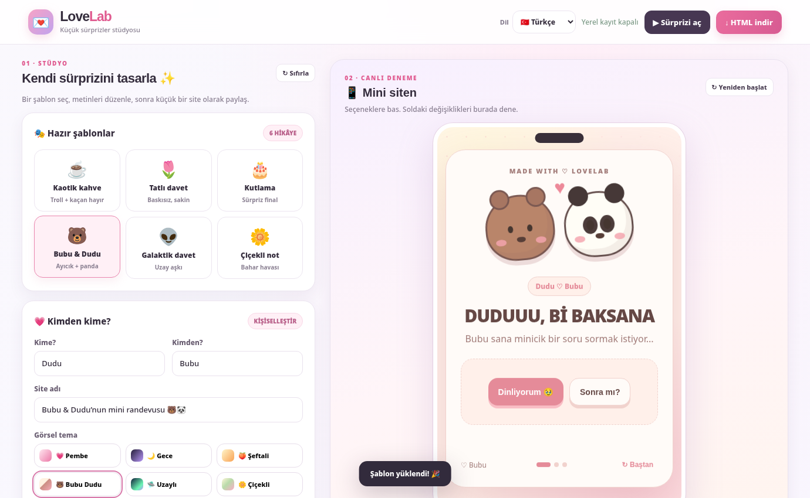

<div align="center">

# 💌 LoveLab Studio

### Create a tiny moment worth sharing.

**A playful, multilingual no-code editor for interactive invitations, mini-stories, and surprises.**

`Vanilla JavaScript` · `HTML + CSS` · `No backend` · `No dependencies` · `Made with ♡`

**🇹🇷 Türkçe · 🇬🇧 English · 🇩🇪 Deutsch**

</div>



---

## ✨ Features / Özellikler

| Feature | What it does |
|---|---|
| 🎭 **6 story templates** | Chaotic Coffee, Sweet Invitation, Celebration, Bubu & Dudu, Galactic Invitation, Flower Note |
| 🎨 **6 visual themes** | Rose, Midnight, Peach, Bear & Panda, Alien, Floral — freely mix with stories |
| 🌍 **3 languages** | Turkish, English and German interface, system prompts and story presets |
| 🧩 **Interactive story builder** | Up to 8 scenes, up to 4 choices per scene, different paths and 2 endings |
| 🏃 **Playful runaway button** | Dodges twice, then lets the visitor choose “no” for real |
| 📱 **Live responsive preview** | See changes before publishing |
| 📤 **Portable export** | Download a *single standalone HTML file* that needs no separate assets |
| 💾 **Local project backups** | Save / restore editable `.lovelab.json` files |
| 🔗 **Link sharing** | When the editor is hosted, encode a mini-site in a shareable URL fragment |

**All new illustrations are rendered using CSS and emoji:** no external image files, image services, or paid APIs. The bear-and-panda theme is an **unofficial, original CSS interpretation** of a cute Bubu & Dudu aesthetic, not official licensed artwork.

## ☕ Try the standalone demos

- 🐻🐼 [Bubu & Dudu — Turkish](examples/bubu-dudu.html)
- 👽 [Galactic invitation — English](examples/galactic.html)
- 🌼 [Flower note — German](examples/flower-note.html)

Each demo is a **self-contained HTML file** you can open or publish independently of LoveLab Studio.

## 🚀 Quick start / Hızlı başlangıç

There is **no installation or npm install** to run the app.

1. Download or clone this repository.
2. Open **`index.html`** in your browser. (Firefox, Chrome and Edge are supported.)
3. Select a template and a language. Customize text and buttons.
4. Preview the story and click **Download HTML** to get a standalone page.

For local development using a server (optional):

```bash
cd LoveLab_v2
python3 -m http.server 8000
```

Then visit **http://localhost:8000**. This setup works with Windows, Ubuntu, or WSL2.

> ⚠️ Choosing English / German changes menus, default prompts and new templates, but **does not machine-translate text you already edited**. Back up your project before replacing it with a different template.

## 🗂️ Project structure

```text
LoveLab_v2/
├── index.html               # Editor: HTML markup
├── assets/
│   └── editor.css           # Editor: styles and responsive layout
├── js/
│   ├── app.js               # Editor: state, DOM, actions, import/export
│   ├── i18n.js              # Translations (TR, EN, DE)
│   ├── templates.js         # 6 editable stories × 3 languages + palettes
│   └── story-template.js    # GENERATED standalone story bundle
├── src/
│   ├── story.html           # Exported website: HTML source
│   ├── story.css            # Exported website: themes & illustrations
│   └── story.js             # Exported website: branching story engine
├── tools/
│   └── build.mjs            # Bundles src/story.* → js/story-template.js
├── docs/
│   ├── preview.png
│   └── LEARNING_GUIDE.md
├── examples/                # Standalone theme demos (TR / EN / DE)
├── tests/
│   └── smoke.mjs            # Dependency-free smoke test
├── CHANGELOG.md
└── README.md
```

**Test the basic assumptions** (no dependencies):

```bash
node tests/smoke.mjs
```

**Why are there two parts?** The **studio** is the editor; the **story** is what recipients see. When a user exports, the editor embeds story HTML, CSS, JavaScript and saved answers into **one HTML file**.

### Changing the exported story's CSS or JavaScript

Edit **`src/story.css`**, **`src/story.js`**, or **`src/story.html`**, then rebuild:

```bash
node tools/build.mjs
```

This command is built with Node.js standard libraries only: **no dependencies and no API keys**.

`js/story-template.js` is generated. Do not edit it by hand — your changes would be overwritten by the next build.

Changing `assets/editor.css` or `js/app.js` does **not** require rebuilding.

## 🧠 How LoveLab works

```text
                          ┌───────────────┐
                          │ Editor UI     │
                          │ index.html    │
                          └───────┬───────┘
                                  │ edits
                          ┌───────▼───────┐
                          │ project       │
                          │ JavaScript obj│
                          └──┬─────────┬──┘
                  browser save│         │ preview/export
                     ┌────────▼───┐ ┌──▼────────────────┐
                     │localStorage│ │ Standalone HTML  │
                     └────────────┘ │ generated from   │
                                    │ src/story.*       │
                                    └───────────────────┘
```

An example answer node:

```js
{ label: 'YES 💗', action: 'success' }
```

Available actions are `next`, `success`, `decline`, `runaway`. The **runaway** button remains a joke, not a refusal blocker. A visitor can always decline after two attempts.

## 🌐 Publish for free using GitHub Pages

1. Create a **public** GitHub repository.
2. Push all LoveLab files while preserving their directories.
3. Open your repository's **Settings → Pages**.
4. Select **Deploy from a branch**, branch **main**, folder **/(root)**, and save.
5. GitHub will provide an address in this form:

```text
https://YOUR-USERNAME.github.io/YOUR-REPOSITORY/
```

There are **no paid Netlify Agent features required**. Your source files also remain available on GitHub.

### Share a mini-site

- **Download HTML**: creates a standalone `.html` file; host it anywhere that supports static files, or share the file itself.
- **Copy link**: when the studio is published, embeds the story in the URL fragment. The recipient opens **only the fullscreen mini-story**, not the editor, by default.
- **Backup project**: creates an editable `.lovelab.json` file. This is the recommended way to preserve work before switching templates or browsers.

## 🔒 Privacy and limits

- This is a **client-side prototype** with no database, user account, analytics, or server-side storage.
- Editor changes are stored in the browser's `localStorage`. Clearing site data removes the local copy; download a project backup.
- Shareable links contain story text as **base64url-encoded JSON (not encrypted)**. **Do not put passwords or private information in your stories.**
- Long stories can generate long links. Sharing a published standalone HTML file is more reliable for longer content.
- Since the story engine only supports `next`, it follows the scene order. Arbitrary graph connections are a future feature.
- Browser behavior, URL limits, and clipboard permissions may vary. On local `file://` links use HTML export instead of the direct link-sharing button.

## 🇹🇷 Nasıl geliştiririm?

- Editör tasarımını değiştirmek için **`assets/editor.css`** dosyasını aç.
- Yeni şablon eklemek için **`js/templates.js`** dosyasını incele.
- Dil eklemek veya metin değiştirmek için **`js/i18n.js`** dosyasından başla.
- Davranışları değiştirmek için **`js/app.js`** ve **`src/story.js`** dosyalarını incele.
- Dışa aktarılan sitenin temalarını değiştirdikten sonra `node tools/build.mjs` çalıştır.
- Öğrenerek ilerlemek için **[LEARNING_GUIDE.md](docs/LEARNING_GUIDE.md)** dosyasını kullan.

## 🌱 Roadmap

- Visual branching-story graph editor
- Per-question background customization and optional self-uploaded illustrations
- Draft autosave history and undo / redo
- Better accessibility and keyboard controls
- Optional backend for shorter share links and accounts
- More locales and community templates

---

<div align="center">

**Built for delightful tiny interactions. Made with curiosity, code, and a little chaos. 💗**

</div>
